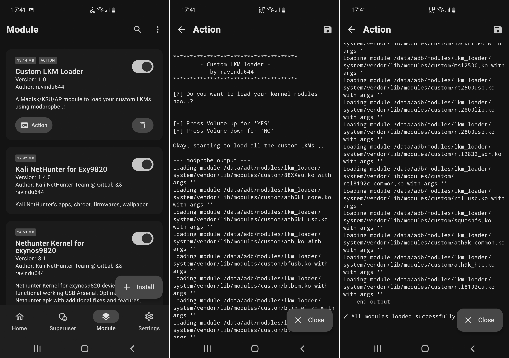
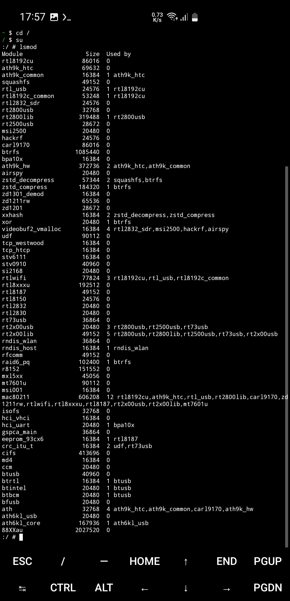

# ⚙️ Custom Loadable Kernel Module Loader

## Introduction

When enabling new drivers in GKI kernels, the kernel build system forces us to build them as "Loadable Kernel Modules" (LKMs) instead of inline drivers.

On some devices (particularly certain OnePlus models), even after placing custom LKMs in the `vendor_dlkm` partition and properly configuring the module files (`modules.load`, `modules.dep`, `modules.alias`, etc.), the phone still refuses to load them.

In such cases, manually using `insmod` through the terminal doesn't work correctly due to dependency issues.

**This Magisk module mimics the default kernel module loading behavior**, allowing developers to ship their custom `.ko` modules as a Magisk module.

  
*Loading all the modules by pressing the "Action" button.*

  
*Listing loaded kernel modules via `lsmod`*

## Features

This module offers two loading modes:

1. **Auto-load during boot**: Select "yes" during installation to automatically load all LKMs at boot time
2. **Manual load**: Select "no" during installation to manually load LKMs using the "Action" button in KernelSU/Magisk/AP Managers after Android finishes booting

---

## Quick Navigation

1. [Requirements](https://github.com/ravindu644/Magisk_LKM_Loader#requirements)  

2. Packaging
    - [Non-GKI kernels](https://github.com/ravindu644/Magisk_LKM_Loader#for-non-gki-kernels)
    - [GKI Kernels](https://github.com/ravindu644/Magisk_LKM_Loader#for-gki-kernels)

3. [Installation](https://github.com/ravindu644/Magisk_LKM_Loader#installation-and-usage)

---

## Requirements

⚠️ **Critical**: The kernel and LKMs **must be built together** in the same build process.

- ✅ **Works**: Custom kernel + matching custom .ko modules (built together)
- ❌ **Won't work**: Stock kernel + custom .ko modules
- ❌ **Won't work**: Different custom kernel + .ko modules from another kernel

## Prerequisites

Install the required dependencies:

```bash
sudo apt install kmod binutils-aarch64-linux-gnu -y
```

**Important**: Fully compile your kernel before proceeding.

---

# 📦 Packaging Your LKMs

## For Non-GKI Kernels

### Step 1: Prepare the Staging Directory

Navigate to your kernel root directory and create a staging folder:

```bash
mkdir -p staging
```

Copy all `.ko` modules to the staging folder:

```bash
for i in $(find . -name "*.ko"); do cp -ar $i staging/ ; done
```

### Step 2: Copy Required Build Files

Copy these files from your kernel root or `out` directory to the `staging` folder:
- `System.map`
- `Module.symvers`
- `modules.builtin`
- `modules.order`

### Step 3: Select Modules (Optional)

If you only want specific modules:
1. Open the `staging` folder
2. Identify the modules that were compiled after enabling `CONFIG_XXXX=m`
3. Copy those specific modules to a separate new folder

**Note**: Skip this step if you want to package all modules.

### Step 4: Set Up LKM Tools

1. Create a new folder to store your packaged modules (e.g., `my_packaged_modules`)
2. Clone the LKM_Tools repository:

```bash
git clone https://github.com/ravindu644/LKM_Tools.git
```

### Step 5: Run the Packaging Script

Navigate to the `LKM_Tools` directory and run:

```bash
./04.prepare_only_nethunter_modules.sh
```

The script will prompt you for:
- **NetHunter modules directory**: 
  - If you completed Step 3: Path to your manually copied modules folder
  - If you skipped Step 3: Path to your `staging` folder
- **Kernel build staging directory**: Path to your `staging` folder
- **vendor_boot.img's modules_list.txt**: Press Enter to skip (not needed for non-GKI kernels)
- **System.map file**: Path to `System.map` in your staging folder
- **Output directory**: Where to save the organized modules (e.g., `my_packaged_modules`)
- **Strip tool path**: Get this with `which aarch64-linux-gnu-strip`

### Step 6: Copy to LKM_Loader

Copy all contents from your output directory to:
```
LKM_Loader/system/vendor/lib/modules/custom/
```

---

## For GKI Kernels

GKI kernels are more complex because modules are distributed across two partitions with specific dependencies.

### Understanding GKI Module Partitions

**`vendor_boot` Partition:**
- Contains essential modules needed for device boot and recovery
- Not accessible from Android userspace
- Usually contains vendor-independent, generic modules
- Examples: Basic drivers needed for the device to start

**`vendor_dlkm` Partition:**
- Contains the majority of kernel modules
- Includes vendor-specific and SoC-dependent modules
- Accessible from Android userspace
- **This is where your custom modules should go**

### Why We Need vendor_boot Information

Some modules in `vendor_dlkm` depend on modules located in `vendor_boot`. 

**Example**: `ath.ko` (in `vendor_dlkm`) may depend on `mac80211.ko` (in `vendor_boot`)

To handle these cross-partition dependencies correctly, we need to extract the module information from `vendor_boot` and generate a module list.

### Step 1: Identify the Staging Directory

In GKI build environments, the staging folder is typically located at:
```
${KERNEL_ROOT}/out/target/product/<your_product_name>/obj/KERNEL_OBJ/staging
```

### Step 2: Extract vendor_boot Module Information

You need to obtain the `modules.dep` file from your device's `vendor_boot` partition:

**Option A: Extract from stock ROM**
- Download your device's stock ROM package
- Extract the `vendor_boot.img` file

**Option B: Dump from device (requires root)**
```bash
dd if=/dev/block/by-name/vendor_boot of=/sdcard/vendor_boot.img
```

**Unpack the image:**
1. Use [Android_boot_image_editor](https://github.com/cfig/Android_boot_image_editor) to unpack `vendor_boot.img`
2. Locate and extract the `modules.dep` file
3. Save it to your PC for the next step

### Step 3: Set Up LKM Tools

1. Create a new folder to store your packaged modules (e.g., `my_packaged_modules`)
2. Clone the LKM_Tools repository:

```bash
git clone https://github.com/ravindu644/LKM_Tools.git
```

3. Navigate to the `LKM_Tools` directory
4. Run the first script to generate `modules_list.txt` from your `vendor_boot` `modules.dep` file

### Step 4: Select Your Custom Modules

1. Open your GKI staging directory
2. Identify the modules that were compiled after enabling `CONFIG_XXXX=m`
3. Copy those specific modules to a separate folder
   - **Important**: Only copy the modules you actually need, not all modules

### Step 5: Run the Packaging Script

Navigate to the `LKM_Tools` directory and run:

```bash
./04.prepare_only_nethunter_modules.sh
```

The script will prompt you for:
- **NetHunter modules directory**: Path to your custom modules folder from Step 4
- **Kernel build staging directory**: Path to your GKI staging folder
- **vendor_boot.img's modules_list.txt**: Path to the `modules_list.txt` generated in Step 3
- **System.map file**: Path to `System.map` in your staging folder
- **Output directory**: Where to save the organized modules (e.g., `my_packaged_modules`)
- **Strip tool path**: Get this with `which aarch64-linux-gnu-strip`

### Step 6: Handle the Two Output Folders

The script creates two separate folders in your output directory:
1. **`vendor_boot`** - Contains modules that belong in the vendor_boot partition
2. **`vendor_dlkm`** - Contains modules for the vendor_dlkm partition

**For the Magisk Module:**
Copy the files from `vendor_dlkm/lib/modules/<kernel_version>` folder to:
```
LKM_Loader/system/vendor/lib/modules/custom/
```

**For vendor_boot modules (if any exist):**
1. Navigate to the `vendor_boot` folder in your output directory
2. Copy any `.ko` modules found there
3. Replace the corresponding modules in your unpacked `vendor_boot.img` (from Step 2)
4. Use [Android_boot_image_editor](https://github.com/cfig/Android_boot_image_editor) to repack the `vendor_boot.img`
5. Keep this modified `vendor_boot.img` ready for flashing

---

## Expected Directory Structure

Your final structure should look like this:

```
LKM_Loader/system/
├── bin/
│   └── keycheck
└── vendor/
    └── lib/
        └── modules/
            └── custom/
                ├── your_module1.ko
                ├── your_module2.ko
                ├── modules.alias
                ├── modules.dep
                ├── modules.devname
                ├── modules.load
                ├── modules.order
                ├── modules.softdep
                ├── modules.symbols
                └── modules.weakdep
```

## Installation and Usage

### Step 1: Create the Magisk Module
1. Place your `.ko` files and module configuration files located inside `output_folder/vendor_dlkm/lib/modules/<kernel_version> folder to` the `LKM_Loader/system/vendor/lib/modules/custom/` folder

2. Zip the entire `LKM_Loader` directory
3. This creates an installable Magisk module

### Step 2: Install the Module
1. Copy the zip file to your phone
2. Install it through Magisk Manager
3. During installation, use the volume keys to choose your preferred loading mode:
   - **Volume Up (Yes)**: Auto-load modules at boot
   - **Volume Down (No)**: Manual load using Action button
4. **Do not reboot yet** after installation

### Step 3: Flash Modified vendor_boot (GKI Only)
**Only for GKI kernels with vendor_boot modules:**

1. Immediately after installing the Magisk module, boot into fastboot mode:
   ```bash
   adb reboot bootloader
   ```
   Or use hardware buttons to enter fastboot/download mode

2. Flash your modified `vendor_boot.img`:
   ```bash
   fastboot flash vendor_boot vendor_boot.img
   ```

3. Reboot your device:
   ```bash
   fastboot reboot
   ```

### Step 4: Activate
- **Auto-load mode**: Your modules should load automatically at boot
- **Manual load mode**: Use the Action button in Magisk Manager when you need the modules

## Troubleshooting

- **Modules fail to load**: Ensure kernel and modules were built together
- **GKI-specific issues**: 
  - Ensure you flashed the modified `vendor_boot.img` after installing the Magisk module

## Important Notes for GKI Kernels

⚠️ **Critical Timing**: For GKI kernels with vendor_boot modules, you must flash the modified `vendor_boot.img` immediately after installing the Magisk module, before the first reboot. This ensures both partition modifications are applied together.

💡 **Backup**: Always keep a backup of your original `vendor_boot.img` before flashing the modified version.
